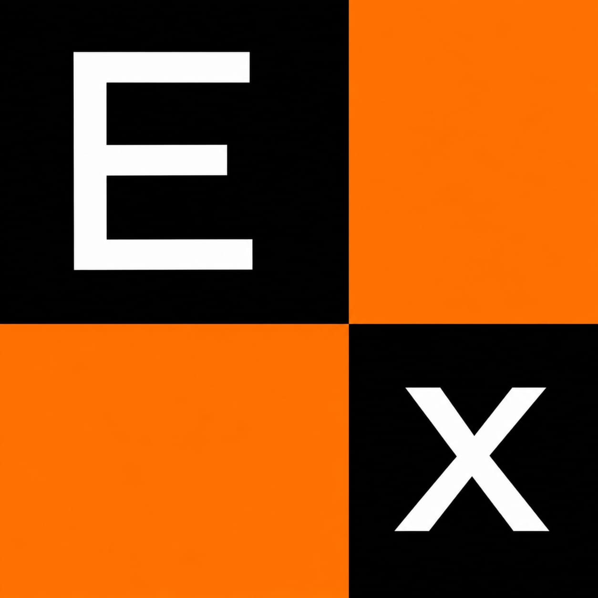
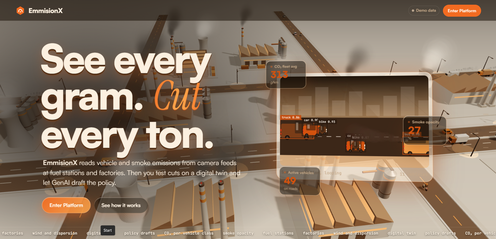
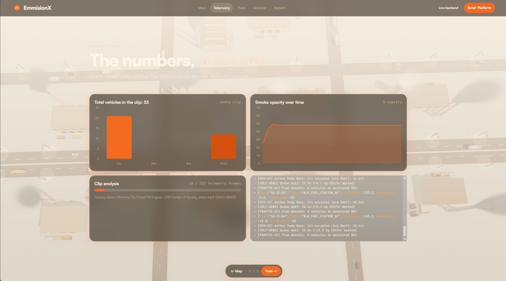
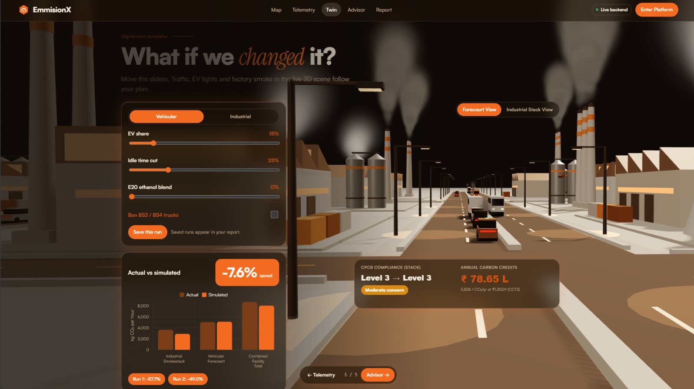
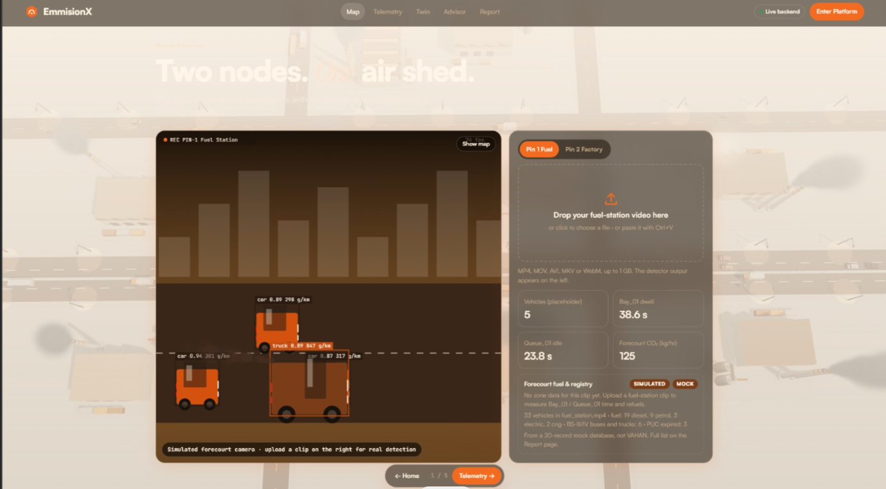
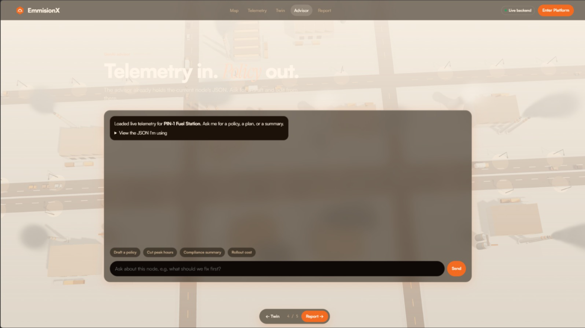
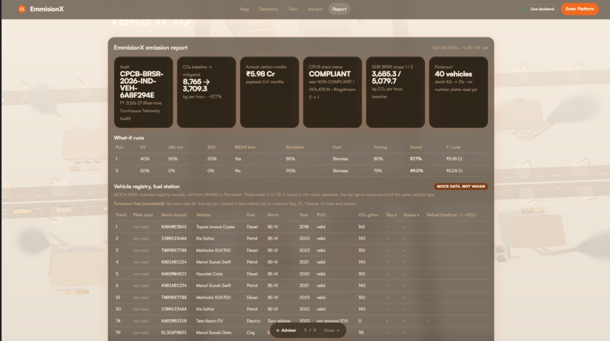
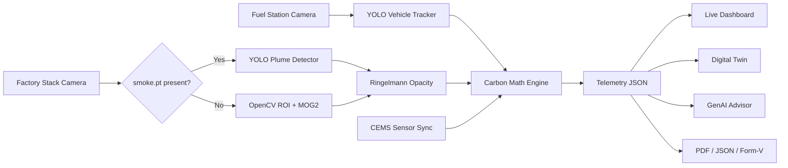

<div align="center">



# EmissionX

### See every gram. *Cut* every ton.

<p align="center">
Real-time carbon emission detection from camera feeds, a 3D digital twin to test cuts,<br/>
and a GenAI advisor that drafts the policy.
</p>

<a href="https://emission-x.vercel.app/">
  
</a>

<br><br>


<br><br>

<a href="#showcase">Showcase</a> •
<a href="#what-it-does">What It Does</a> •
<a href="#how-it-works">How It Works</a> •
<a href="#digital-twin">Digital Twin</a> •
<a href="#quickstart">Quickstart</a> •
<a href="#roadmap">Roadmap</a>

</div>

---

## Showcase

> 📸 Screenshots below are placeholders. Capture each from [emission-x.vercel.app](https://emission-x.vercel.app/) and save into `docs/screenshots/`.

### Landing

<div align="center">



<br><br>

A procedural 3D scene of factories, roads and vehicles sits behind the whole app and reacts to your simulation sliders.

</div>

---


### Telemetry

<div align="center">



<br><br>

CO₂ by vehicle class, smoke opacity over time, clip analysis progress, and a terminal tailing the raw JSON the backend emits, refreshed every second.

</div>

---

### Digital Twin

<div align="center">




<br><br>

Move a slider and watch traffic, EV lights and factory smoke in the 3D scene follow your plan, with actual vs simulated savings, CPCB compliance level and annual carbon credits.

</div>

---

### GenAI Advisor & Report

<div align="center">




<br><br>

The advisor already holds the current node's telemetry. Ask for a draft policy, a compliance summary or a rollout cost, then export everything for the meeting.

</div>

---

## What It Does

| | Pillar | What happens |
|---|---|---|
| 🚗 | **Vehicle emissions** | YOLO tracks cars, trucks, buses and bikes across fuel station forecourts. Each vehicle gets a class, a dwell time, a fuel estimate and a CO₂ number, all from one camera. |
| 🏭 | **Industrial smoke** | A second camera watches the factory stack. Background subtraction isolates the plume, grayscale intensity gives opacity, and the Ringelmann grade sets the emission multiplier. |
| 🧪 | **Digital twin** | The same emission engine that scores the live feed runs your what-if scenario. |
| 🤖 | **GenAI advisor** | Live JSON (baseline CO₂, simulation delta, weather, CV alerts) goes into Groq or Gemini. You get three immediate fixes and a long-term ROI plan, then keep chatting. |
| 📄 | **Reports** | Export raw JSON, a PDF report, or a CPCB Form-V certificate. |

---

## How It Works



### Ringelmann scale

$$\text{Opacity \%} = \text{clamp}\left(\left(1 - \frac{\text{Mean Brightness}}{255}\right) \times 100,\ 0,\ 100\right)$$

| Opacity | Grade | Status | Multiplier |
|---|---|---|---|
| 0 – 20% | 0 – 1 | 🟢 `NORMAL` | 1.00× |
| 21 – 60% | 2 – 3 | 🟠 `COMBUSTION WARNING` | 1.25× |
| 60%+ | 4 – 5 | 🔴 `SCRUBBER VIOLATION` | 1.60× |

### Industrial formula

$$\text{CO}_2 = \text{Fuel Rate} \times \text{EF} \times \text{Opacity Mult} \times (1 - \text{Scrubber Eff})$$

| Fuel | Emission factor |
|---|---|
| Coal | 2.42 kg CO₂ / kg |
| Furnace oil | 3.15 kg CO₂ / kg |
| Natural gas | 1.93 kg CO₂ / m³ |
| Biomass | 0.45 kg CO₂ / kg (net) |

**Worked example:** 1245 kg/hr coal at 64.2% opacity → 1245 × 2.42 × 1.6 = **4820.6 kg CO₂/hr**, of which **1807.7** is avoidable waste.

### Dual-mode plume detector

| Mode | Trigger | Method |
|---|---|---|
| **Primary** | `models/smoke.pt` exists | YOLO (`vid_stride=3`, `imgsz=480`) |
| **Fallback** | No weights | OpenCV MOG2 + brightness analysis + morphology on the chimney-exit ROI |

The fallback never crashes and runs on any video.

---

## Digital Twin

| Vehicular levers | Industrial levers |
|---|---|
| EV adoption (0–100%) | Boiler fuel switch (Coal / Oil / Gas / Biomass) |
| E20 ethanol blend (0–100%) | Carbon scrubber (0–90%) |
| Queue wait reduction (0–100%) | Combustion tuning (reduces opacity) |
| BS3 / BS4 truck ban (toggle) | |

Outputs: projected savings %, actual vs simulated CO₂, **CPCB compliance** shift (e.g. Level 4 → Level 1), and **annual carbon credits** at an assumed ₹1,000 per tonne CO₂.

Saved runs are bundled into the exported report.

---

## Smart Replay Cache

Process once, replay forever. `stream_industrial_telemetry(use_cache=True)` streams at **60 FPS with under 2% CPU and zero GPU load**.

| Output | Path |
|---|---|
| Annotated video | `cache/factory_annotated.mp4` |
| Telemetry | `cache/factory_telemetry.json` |

---

## Quickstart

```bash
git clone https://github.com/dhanushcs32-pixel/EmissionX.git
cd EmissionX
cp .env.example .env        # add your Groq / Gemini keys
```

**Run the industrial pipeline end to end**

```bash
pip install -e .
python run_industrial.py    # or: uv run run_industrial.py
```

**Run the app**

```bash
python main.py              # backend, see README_backend.md
npm install && npm run dev  # frontend (Vite)
```

> Windows: `run.bat` starts everything in one go.

<details>
<summary><b>Sample telemetry payload</b></summary>

```json
{
  "node_id": "IND_STACK_01_PEENYA",
  "sector": "industrial",
  "timestamp": "2026-10-15T11:30:00Z",
  "environment": { "temp_c": 29.5, "wind_kmh": 11.2, "wind_deg": 240, "aqi": 168 },
  "cv_telemetry": {
    "smoke_opacity_pct": 64.2,
    "ringelmann_level": 4,
    "opacity_multiplier": 1.6,
    "cems_metrics": {
      "fuel_type": "coal",
      "fuel_rate_kg_hr": 1245.0,
      "flue_gas_temp_c": 218.4,
      "so2_ppm": 285
    }
  },
  "emissions": { "baseline_co2_kg_hr": 4820.6, "waste_co2_kg_hr": 1807.7 },
  "simulation": {
    "active": false,
    "projected_co2_kg_hr": 4820.6,
    "reduction_pct": 0.0
  }
}
```

</details>

<details>
<summary><b>Repository structure</b></summary>

```
EmissionX
├── .github/workflows/
├── backend/
├── modules/industrial_detector.py
├── models/            # optional smoke.pt
├── cache/
├── src/               # frontend
├── tests/
├── run_industrial.py
├── main.py
├── index.html
├── vite.config.ts
└── pyproject.toml
```

</details>

---

## Tech Stack

| Layer | Tools |
|---|---|
| Vision | YOLO, OpenCV (MOG2) |
| Backend | Python, FastAPI, Pydantic |
| Frontend | TypeScript, Vite, Three.js, Chart.js |
| GenAI | Groq, Gemini |
| CI | GitHub Actions |

---

## Roadmap

- [x] Vehicle tracking and per-class CO₂ at fuel stations
- [x] Ringelmann smoke opacity with dual-mode detector
- [x] 3D digital twin with CPCB compliance and carbon credits
- [x] GenAI policy advisor and PDF / JSON / Form-V export
- [ ] Live RTSP camera ingestion
- [ ] Real CEMS hardware (Modbus / MQTT)
- [ ] Released trained smoke model
- [ ] Multi-node dashboard with alerts

---

## Disclaimer

All demo data is simulated. Thresholds and advice are indicative; check local pollution-control norms before acting.

## Team

Built for the **DSU Hackathon** by [@dhanushcs32-pixel](https://github.com/dhanushcs32-pixel) _
<div align="center">

<br>

**[▶ Try the live demo](https://emission-x.vercel.app/)** · If it caught your eye, drop a ⭐

</div>
