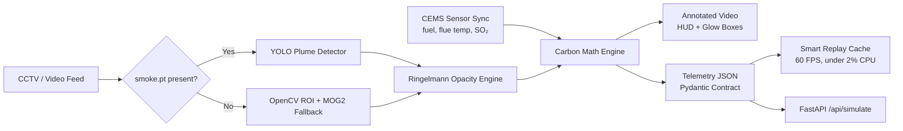

<div align="center">

<!-- TODO: add a logo (e.g. ./docs/assets/logo.gif) -->


# EmissionX

### Carbon Footprint Intelligence Platform

<p align="center">
See smoke. Measure it. Put a number on the carbon.<br/>
Computer vision + IoT sensor fusion that turns a CCTV feed of a smokestack into real-time CO₂ telemetry.
</p>

<br>


<br><br>

<a href="#demo">Demo</a> •
<a href="#the-problem">Problem</a> •
<a href="#how-it-works">How It Works</a> •
<a href="#features">Features</a> •
<a href="#quickstart">Quickstart</a> •
<a href="#api--schema">API</a> •
<a href="#roadmap">Roadmap</a>

</div>

---

## Demo

<div align="center">

<!-- TODO: replace with real captures. Suggested: 3 frames (NORMAL / WARNING / VIOLATION) + 1 dashboard shot -->


<br><br>

The same chimney, three states: the glow box shifts from neon green to amber to crimson as opacity climbs, while the HUD updates fuel burn, CO₂ rate and status in real time.

<br>


<br><br>

Live dashboard with telemetry, what-if simulation and replay.

</div>

> 🎥 **Demo video:** _add link here_

---

## The Problem

Industrial stacks are one of the largest and least-measured sources of urban carbon and particulate emissions. Continuous Emission Monitoring Systems (CEMS) are expensive, and a camera on a chimney is cheap but gives you pixels, not numbers.

**EmissionX bridges that gap.** It reads smoke opacity straight from video, fuses it with boiler sensor metrics, and converts both into a deterministic **kg CO₂ per hour** figure, plus the *avoidable* share of it, so operators and regulators see what a scrubber failure actually costs.

---

## How It Works



---

## Features

### 🔍 Dual-Mode Plume Detector

Works out of the box, with or without a GPU or trained weights.

| Mode | Trigger | Method |
|---|---|---|
| **Primary** | `models/smoke.pt` exists | YOLO detection (`vid_stride=3`, `imgsz=480`) |
| **Fallback** | No weights found | OpenCV MOG2 background subtraction + brightness analysis + morphological filtering on the chimney-exit ROI |

The fallback path never crashes and runs on any video.

### 🌫️ Optical Ringelmann Opacity

The plume ROI is converted to grayscale and scored by mean brightness:

$$\text{opacity\_pct} = \text{clamp}\left(\left(1 - \frac{\text{mean\_brightness}}{255}\right) \times 100,\ 0,\ 100\right)$$

| Opacity | Ringelmann | Status | Multiplier | HUD Color |
|---|---|---|---|---|
| 0 – 20% | 0 – 1 | `NORMAL` | 1.00× | 🟢 Neon green |
| 21 – 60% | 2 – 3 | `COMBUSTION WARNING` | 1.25× | 🟠 Amber |
| > 60% | 4 – 5 | `SCRUBBER VIOLATION` | 1.60× | 🔴 Crimson |

### 📡 Synthetic CEMS Sensor Sync

Boiler and stack metrics are generated and tied to plume opacity, so the demo behaves like a real plant.

| Metric | Field | Range |
|---|---|---|
| Fuel rate | `fuel_rate_kg_hr` | ~1200 kg/hr base, spikes above 50% opacity |
| Flue gas temp | `flue_gas_temp_c` | 160 – 240 °C |
| SO₂ | `so2_ppm` | 80 → 350 ppm during Ringelmann 4–5 |

Each frame also emits tagged audit logs (`[PLUME-CV]`, `[CEMS-IOT]`).

### 🧮 Deterministic Carbon Math Engine

One engine shared by the video pipeline and `/api/simulate`, so live and what-if numbers always agree.

| Fuel | Emission factor |
|---|---|
| Coal | 2.42 kg CO₂ / kg |
| Furnace oil | 3.15 kg CO₂ / kg |
| Natural gas | 1.93 kg CO₂ / m³ |
| Biomass | 0.45 kg CO₂ / kg (net lifecycle) |

$$\text{baseline\_co2\_kg\_hr} = (\text{fuel\_rate} \times \text{factor}) \times \text{opacity\_multiplier} \times (1 - \text{scrubber\_efficiency})$$

$$\text{waste\_co2\_kg\_hr} = \text{baseline\_co2\_kg\_hr} - (\text{fuel\_rate} \times \text{factor})$$

**Worked example** (matches the sample payload below): 1245 kg/hr coal at 64.2% opacity (Ringelmann 4)

```
ideal   = 1245 × 2.42        = 3012.9 kg CO₂/hr
actual  = 3012.9 × 1.60      = 4820.6 kg CO₂/hr   ← baseline
waste   = 4820.6 − 3012.9    = 1807.7 kg CO₂/hr   ← avoidable with a working scrubber
```

### 🎯 Tactical HUD Annotation

Glowing bounding boxes with corner reticles and plume tags, plus a glassmorphism banner showing opacity, Ringelmann level, fuel burn, CO₂ rate, status and flue diagnostics.

### ⚡ Smart Replay Cache

Process once, replay forever. `stream_industrial_telemetry(use_cache=True)` streams cached results at **60 FPS with under 2% CPU and zero GPU load**.

| Output | Path |
|---|---|
| Annotated video | `cache/factory_annotated.mp4` |
| Telemetry contract | `cache/factory_telemetry.json` |

---

## Quickstart

### Prerequisites

- Python 3.10+ (check `pyproject.toml` for the exact version)
- Node.js 18+ (for the frontend)
- Optional: a GPU and your own `models/smoke.pt`

### 1. Clone

```bash
git clone https://github.com/dhanushcs32-pixel/EmissionX.git
cd EmissionX
cp .env.example .env     # then fill in values
```

### 2. Run the end-to-end pipeline

```bash
pip install -e .
python run_industrial.py
```

or with [uv](https://github.com/astral-sh/uv):

```bash
uv run run_industrial.py
```

The runner will:

1. Verify or synthesize smokestack CCTV footage (`factory_stack.mp4`)
2. Run the full detection and telemetry pipeline
3. Write `cache/factory_annotated.mp4` and `cache/factory_telemetry.json`
4. Validate every record against the strict Pydantic schema
5. Benchmark what-if simulations and 60 FPS cache streaming

### 3. Start the app

```bash
# Backend (FastAPI), see README_backend.md for details
python main.py

# Frontend (Vite)
npm install
npm run dev
```

> On Windows, `run.bat` launches the project in one step.

### Environment variables

See [`.env.example`](./.env.example) for the full list.

---

## API & Schema

Every payload conforms to one strict contract, so any dashboard, alerting system or downstream model can consume it unchanged. Details for the backend live in [`README_backend.md`](./README_backend.md).

<details>
<summary><b>View sample telemetry payload</b></summary>

```json
{
  "node_id": "IND_STACK_01_PEENYA",
  "sector": "industrial",
  "timestamp": "2026-10-15T11:30:00Z",
  "environment": {
    "temp_c": 29.5,
    "wind_kmh": 11.2,
    "wind_deg": 240,
    "aqi": 168
  },
  "cv_telemetry": {
    "active_counts": {},
    "bay_dwell_sec": null,
    "queue_idle_sec": null,
    "smoke_opacity_pct": 64.2,
    "ringelmann_level": 4,
    "opacity_multiplier": 1.6,
    "cems_metrics": {
      "fuel_type": "coal",
      "fuel_rate_kg_hr": 1245.0,
      "flue_gas_temp_c": 218.4,
      "so2_ppm": 285
    },
    "recent_logs": [
      " [PLUME-CV] Smoke Opacity 64.2% (Ringelmann Lvl 4) -> Penalty 1.6x",
      " [CEMS-IOT] Boiler #1 Coal Feed: 1245 kg/hr | Flue Temp: 218.4C | SO2: 285 ppm"
    ]
  },
  "emissions": {
    "baseline_co2_kg_hr": 4820.6,
    "waste_co2_kg_hr": 1807.7
  },
  "simulation": {
    "active": false,
    "projected_co2_kg_hr": 4820.6,
    "reduction_pct": 0.0,
    "applied_params": {
      "fuel_type": "coal",
      "scrubber_efficiency_pct": 0,
      "combustion_tuning_pct": 0
    }
  }
}
```

</details>

### What-if simulation

`POST /api/simulate` re-runs the same math engine with changed parameters (fuel type, scrubber efficiency, combustion tuning) and returns `projected_co2_kg_hr` and `reduction_pct`, so you can answer *"what if we install a 90% scrubber?"* instantly.

---

## Tech Stack

| Layer | Tools |
|---|---|
| Computer vision | OpenCV (MOG2), Ultralytics YOLO |
| Backend | Python, FastAPI, Pydantic |
| Frontend | React, TypeScript, Vite |
| Tooling | uv / pip, GitHub Actions |

---

<details>
<summary><b>Repository Structure</b></summary>

```
EmissionX
├── .github/workflows/        # CI
├── backend/                  # FastAPI service
├── modules/
│   └── industrial_detector.py   # Detector, CEMS sync, math engine, replay cache
├── models/                   # Drop optional smoke.pt here
├── cache/                    # Annotated video + telemetry JSON
├── src/                      # Frontend source
├── tests/
├── run_industrial.py         # End-to-end runner, CCTV synthesizer, validator
├── main.py
├── index.html
├── vite.config.ts
├── pyproject.toml
└── .env.example
```

</details>

---

## Roadmap

- [x] Dual-mode plume detection (YOLO + OpenCV fallback)
- [x] Ringelmann opacity scoring and status classification
- [x] Deterministic CO₂ engine with what-if simulation
- [x] Smart replay cache for low-power playback
- [ ] Live RTSP camera ingestion
- [ ] Real CEMS hardware integration (Modbus / MQTT)
- [ ] Trained smoke model released in `models/`
- [ ] Multi-stack dashboard with alerts and regulator export
- [ ] Remaining platform pillars (see main project docs)

---

## Team

Built for the **DSU Hackathon** by [@dhanushcs32-pixel](https://github.com/dhanushcs32-pixel) _(add teammates here)_.

## License

_Add a license (MIT is a common choice for hackathon projects)._

<div align="center">

<br>

**If EmissionX caught your eye, drop a ⭐**

</div>
